# Práctica 5 · Ejercicio 1. Forma Normal de Chomsky con JFLAP

[← Volver al índice](../../README.md)

Las gramáticas están en [`gramaticas/practica5/`](../../gramaticas/practica5/): la original (`nombre.jff`) y
la que exporta JFLAP al terminar *Transform Grammar* (`nombre-FNC.jff`). Las capturas son de la ventana de
JFLAP 7.1 y están en [`evidencias/practica5/jflap/`](../../evidencias/practica5/jflap/), junto con un
`resultado.tsv` por gramática con el texto que mostró JFLAP en cada etapa. Para no repetir a mano los mismos
clics en cada gramática, [`herramientas/JflapGramatica.java`](../../herramientas/JflapGramatica.java) abre la
ventana de JFLAP, elige las opciones del menú (*Test for Grammar Type*, *Transform Grammar*, *Multiple Brute
Force Parse*, *CYK Parse*), pulsa *Do All*, *Proceed* y *Export* y guarda la captura de cada paso; se ejecuta
con `python herramientas/practica5_gramaticas.py`.

En JFLAP las mayúsculas son variables, los demás caracteres son terminales y la variable inicial es el lado
izquierdo de la primera producción.

## Qué hace cada etapa de *Transform Grammar*

JFLAP aplica las etapas en este orden, que es el que garantiza que una etapa no deshaga la anterior
(Hopcroft et al., 2007, § 7.1.4; Linz, 2017, § 6.1):

| Etapa | Pestaña de JFLAP | Qué se calcula | Qué queda |
|---|---|---|---|
| 1. Producciones λ | *Lambda Removal* | El conjunto de variables anulables (las que derivan λ) | Por cada producción, todas las versiones que resultan de omitir variables anulables; ninguna producción A → λ |
| 2. Producciones unitarias | *Unit Removal* | El grafo de dependencias: una flecha A → B por cada producción unitaria A → B | Si A ⇒* B solo con unitarias, A recibe las producciones no unitarias de B; ninguna producción A → B |
| 3. Símbolos inútiles | *Useless Removal* | Las variables que derivan cadenas de terminales y, después, las alcanzables desde S | Solo variables que derivan algo y se alcanzan desde S |
| 4. Chomsky | *Chomsky Converter* | Una variable por cada terminal que aparece en un lado derecho largo y una variable por cada «corte» | Solo producciones A → BC y A → a |

## Gramática propia

La gramática se diseñó para que cada etapa tenga trabajo: dos producciones λ, tres producciones unitarias,
una variable que no deriva ninguna cadena (C), dos que no se alcanzan desde S (E desde el principio y D al
desaparecer las unitarias) y, además, recursión por la izquierda (B → Bc), que se aprovecha en el
[Ejercicio 2](02-greibach-bnf.md).

```
S → AB | C
A → aAb | λ
B → Bc | D
D → d | λ
C → CS | aC
E → eA
```

A genera aⁿbⁿ, D genera d o λ y B genera lo de D seguido de ceros o más c; C nunca termina de derivar. Por
eso

**L(G) = { aⁿbⁿ w cᵐ : n ≥ 0, m ≥ 0, w ∈ {d, λ} }**,

que no es regular (por la parte aⁿbⁿ) y contiene a λ (n = m = 0, w = λ).

### Captura y tipo

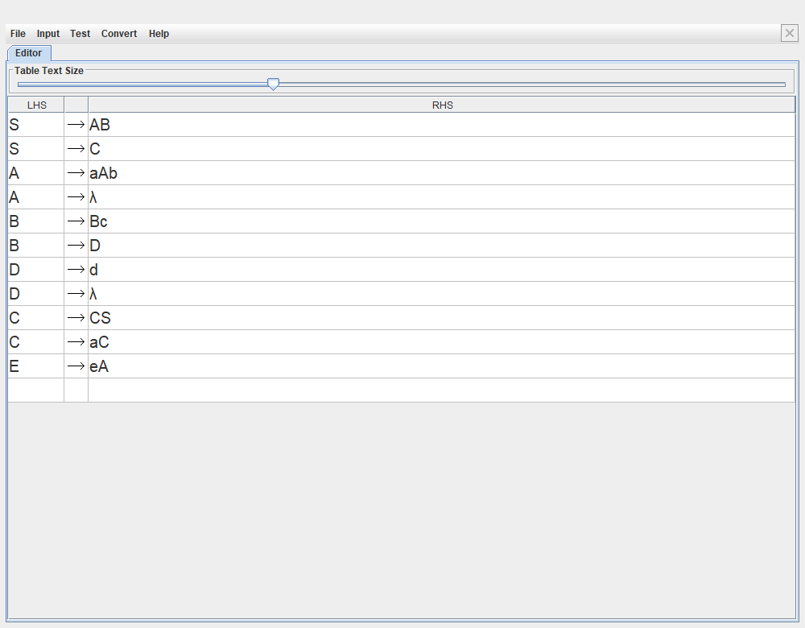

*Test > Test for Grammar Type* responde «This is a Context-Free Grammar»: todos los lados izquierdos son una
sola variable, y no es regular porque S → AB y A → aAb no son lineales por la derecha ni por la izquierda.


### Etapa 1: eliminación de producciones λ

Al elegir *Convert > Transform Grammar*, JFLAP avisa primero de que la variable inicial deriva λ (ver
[«La cadena λ»](#la-cadena-λ)):

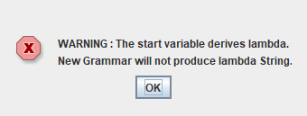

Variables anulables: A y D lo son directamente (A → λ, D → λ); B lo es por B → D; S lo es por S → AB con A y B
anulables. C no lo es. JFLAP muestra el mismo conjunto: «Set that derives lambda: [A, B, S, D]».

Para cada producción se agregan las versiones que omiten variables anulables y se quitan las producciones λ:

| Producción | Versiones que se agregan |
|---|---|
| S → AB | S → A, S → B (omitir las dos daría S → λ, que no se agrega) |
| A → aAb | A → ab |
| B → Bc | B → c |
| C → CS | C → C |
| E → eA | E → e |
| A → λ, D → λ | se eliminan |

```
S → AB | C | A | B
A → aAb | ab
B → Bc | D | c
D → d
C → CS | aC | C
E → eA | e
```

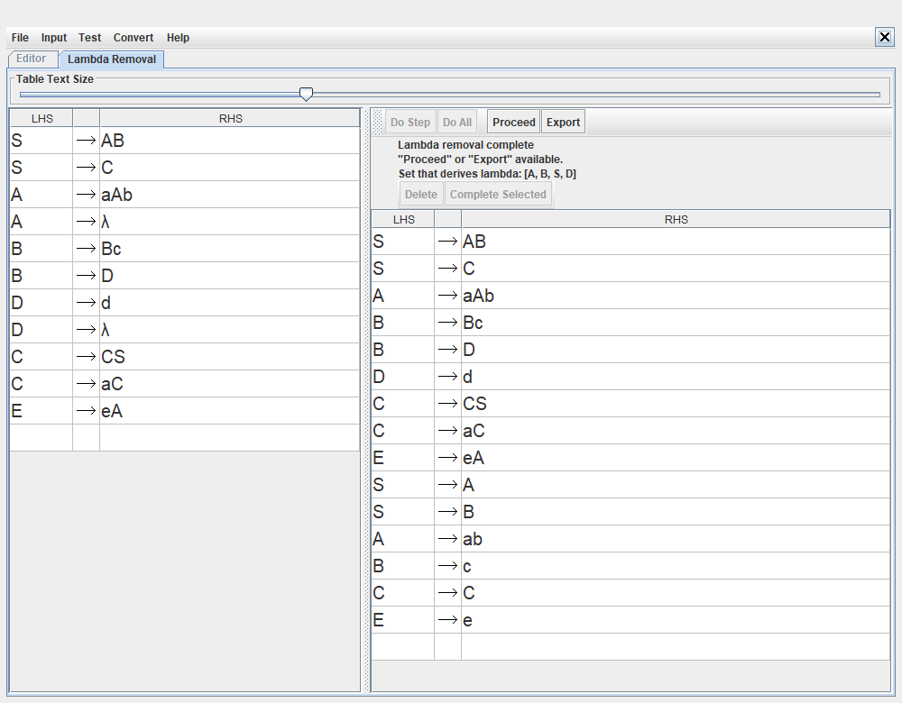

JFLAP conserva C → C, que sale de C → CS al omitir S. Es una producción unitaria que no aporta nada y
desaparece en la etapa siguiente.

### Etapa 2: eliminación de producciones unitarias

Las producciones unitarias son S → C, S → A, S → B, B → D y C → C; JFLAP pide dibujarlas como flechas del grafo
de dependencias («5 more transition(s) needed»). Del grafo se lee qué variables se alcanzan desde cada una
usando solo unitarias:

| Variable | Alcanza por unitarias | Producciones no unitarias que recibe |
|---|---|---|
| S | C, A, B y, por B, D | de C: CS, aC · de A: aAb, ab · de B: Bc, c · de D: d |
| B | D | de D: d |
| C | C | ninguna nueva |

```
S → AB | CS | aC | aAb | ab | Bc | c | d
A → aAb | ab
B → Bc | c | d
D → d
C → CS | aC
E → eA | e
```

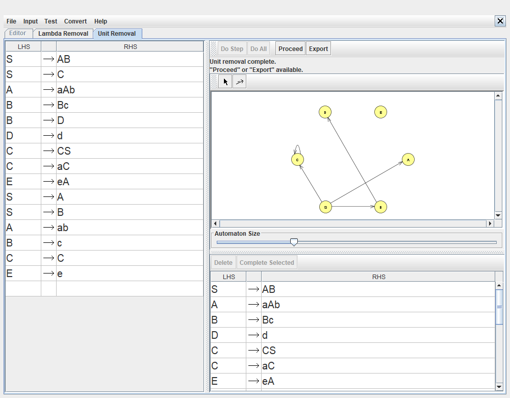

### Etapa 3: eliminación de símbolos inútiles

Primero, las variables que derivan alguna cadena de terminales: A (A → ab), B (B → c), D (D → d), E (E → e) y
S (S → c). C no está: sus dos producciones, C → CS y C → aC, vuelven a contener C, así que ninguna derivación
desde C termina. JFLAP lo muestra como «Variables that predicate terminals: [A, B, D, E, S]». Se eliminan C y
toda producción donde aparece: C → CS, C → aC, S → CS y S → aC.

Después, con lo que queda, las variables alcanzables desde S: en el grafo de dependencias de la captura, S
llega a A y a B, y nada llega a D ni a E. D dejó de ser alcanzable al sustituirse B → D en la etapa 2, y E nunca
lo fue. Se eliminan D → d, E → eA y E → e, y con ellas el terminal e.

```
S → AB | aAb | ab | Bc | c | d
A → aAb | ab
B → Bc | c | d
```

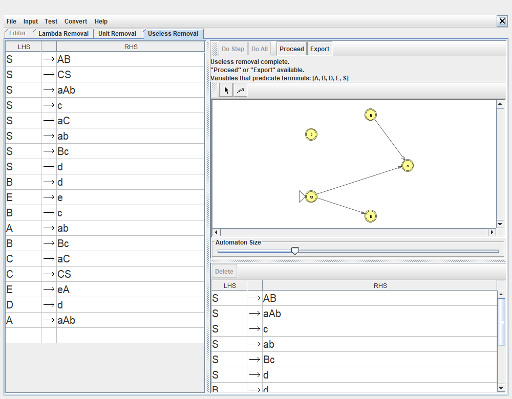

El orden importa: si se quitaran primero las inalcanzables y después las que no derivan nada, en otra
gramática podrían quedar variables inalcanzables al final (Hopcroft et al., 2007, § 7.1.1). JFLAP usa el
orden correcto.

### Etapa 4: paso a la Forma Normal de Chomsky

JFLAP indica «6 production(s) must be converted»: las que no tienen la forma A → BC ni A → a.

| Producción | Se reemplaza por |
|---|---|
| S → aAb | S → B(a) D(1), D(1) → A B(b) |
| S → ab | S → B(a) B(b) |
| S → Bc | S → B B(c) |
| A → aAb | A → B(a) D(1) |
| A → ab | A → B(a) B(b) |
| B → Bc | B → B B(c) |
| nuevas | B(a) → a, B(b) → b, B(c) → c |

B(a), B(b) y B(c) son los nombres provisionales de las variables que sustituyen a los terminales a, b y c, y
D(1) el de la que parte el lado derecho de longitud 3 (aAb = a · Ab).

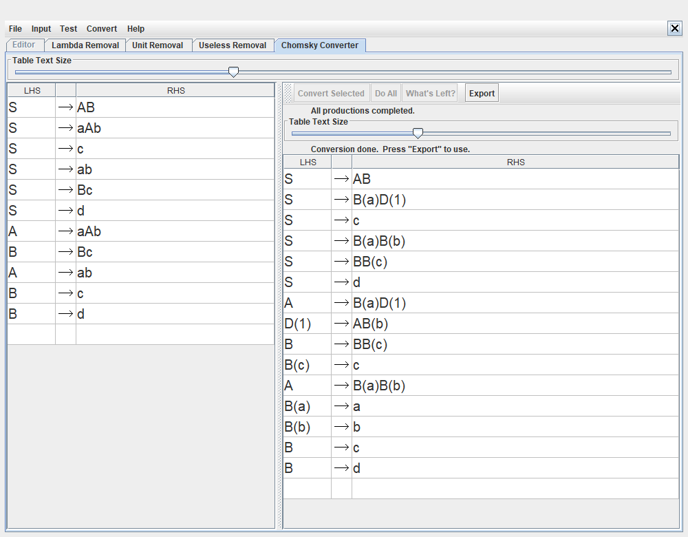

Al pulsar *Export*, JFLAP renombra las variables provisionales con letras libres: B(a) = C, B(b) = D,
B(c) = E y D(1) = F. Las letras C, D y E ya no son las de la gramática original (aquellas se eliminaron en
la etapa 3). La gramática exportada, [`propia-FNC.jff`](../../gramaticas/practica5/propia-FNC.jff), es:

```
S → AB | CF | CD | BE | c | d
A → CF | CD
F → AD
B → BE | c | d
C → a
D → b
E → c
```

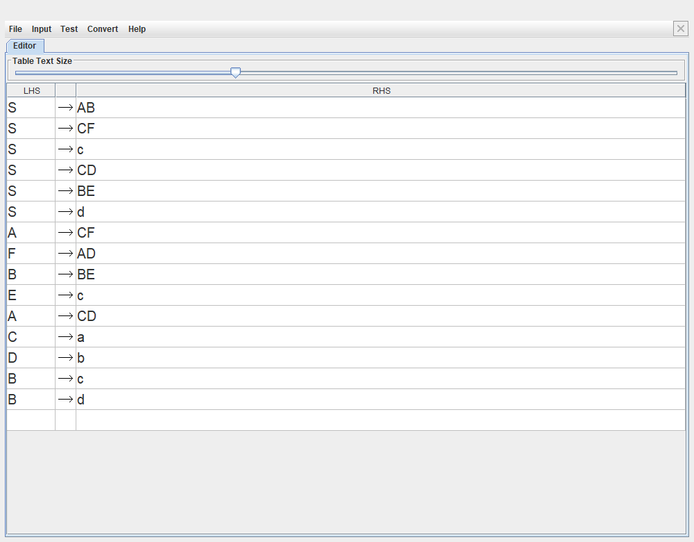

*Test for Grammar Type* sobre la exportada responde «This is a CNF Grammar (also Context-Free Grammar)».

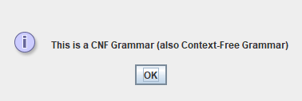

### Equivalencia con *Multiple Brute Force Parse*

Las mismas diez cadenas en la gramática original y en la transformada:

| Cadena | ¿Pertenece a L(G)? | Por qué | Original | FNC |
|---|---|---|---|---|
| `ab` | sí | n = 1 | Accept | Accept |
| `c` | sí | n = 0, w = λ, m = 1 | Accept | Accept |
| `d` | sí | n = 0, w = d, m = 0 | Accept | Accept |
| `abcc` | sí | n = 1, w = λ, m = 2 | Accept | Accept |
| `aabbdcc` | sí | n = 2, w = d, m = 2 | Accept | Accept |
| `ba` | no | b antes que a | Reject | Reject |
| `aab` | no | más a que b | Reject | Reject |
| `cd` | no | d después de c | Reject | Reject |
| `abab` | no | a después de b | Reject | Reject |
| `dd` | no | dos d | Reject | Reject |

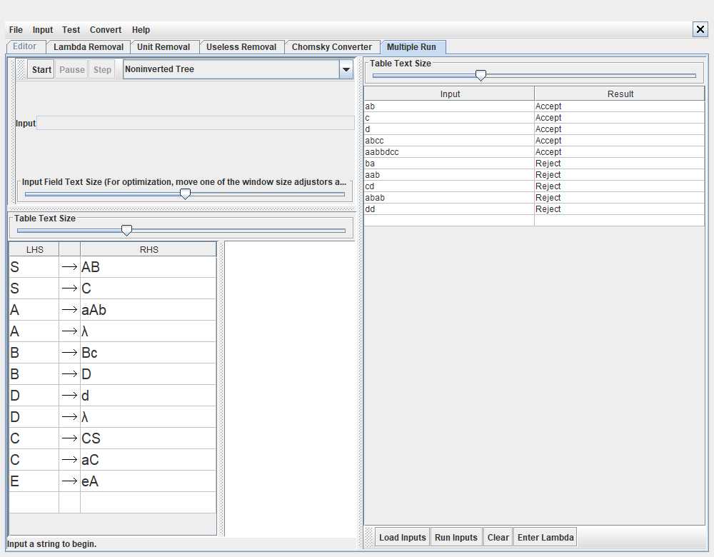

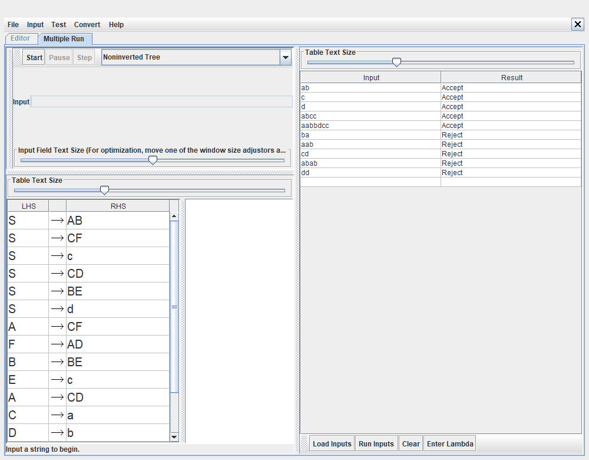

Diez cadenas no demuestran la equivalencia. Por eso
[`tests/test_practica5_gramaticas.py`](../../tests/test_practica5_gramaticas.py) compara, sin JFLAP, **todas**
las cadenas de longitud ≤ 10 que genera cada archivo: la original genera 66 y la transformada 65, las mismas
salvo λ.

### Análisis con *CYK Parse*

Cadena `aabbdcc` en la gramática transformada. JFLAP completa el árbol en 13 pasos y responde «String is
Accepted!».

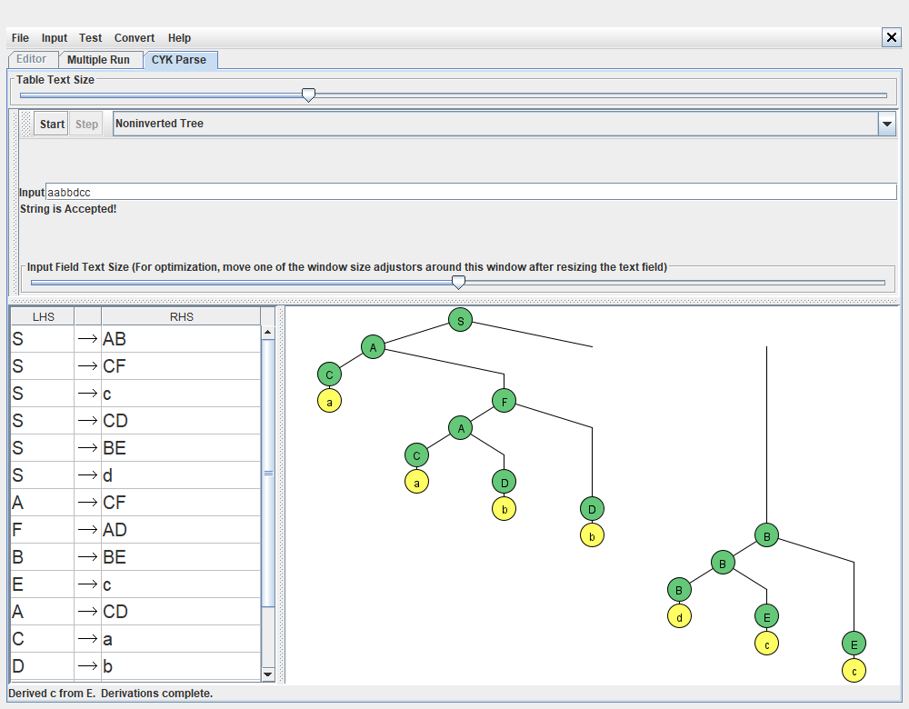

La vista *Derivation Table* da la derivación, que es por la izquierda:

| Paso | Producción | Forma sentencial |
|---|---|---|
| 0 | | S |
| 1 | S → AB | AB |
| 2 | A → CF | CFB |
| 3 | C → a | aFB |
| 4 | F → AD | aADB |
| 5 | A → CD | aCDDB |
| 6 | C → a | aaDDB |
| 7 | D → b | aabDB |
| 8 | D → b | aabbB |
| 9 | B → BE | aabbBE |
| 10 | B → BE | aabbBEE |
| 11 | B → d | aabbdEE |
| 12 | E → c | aabbdcE |
| 13 | E → c | aabbdcc |

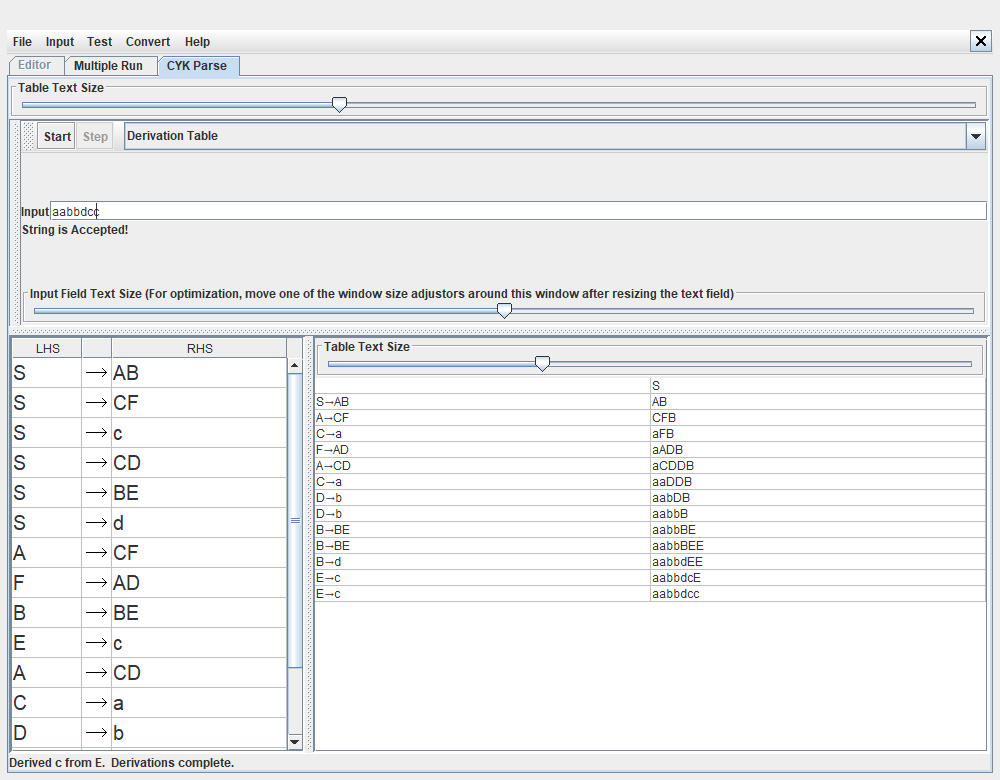

Son 13 = 2 · 7 − 1 pasos: seis producciones A → BC, que llevan de una variable a siete, y siete producciones
A → a, una por símbolo. Es lo que ocurre con toda cadena en la Forma Normal de Chomsky (ver la comparación del
[Ejercicio 2](02-greibach-bnf.md#comparación-de-las-tres-formas)).

### La cadena λ

La gramática original genera λ: S ⇒ AB ⇒ B ⇒ D ⇒ λ (con A → λ y D → λ). La gramática en Forma Normal de Chomsky
**no** la genera, y ninguna gramática en esa forma puede hacerlo: con producciones A → BC y A → a, cada paso
de una derivación o aumenta en uno el número de símbolos o cambia una variable por un terminal, así que desde
S nunca se llega a una cadena de longitud 0. Lo que se obtiene es una gramática para L(G) − {λ} (Hopcroft et
al., 2007, teorema 7.16).

JFLAP lo advierte al empezar la transformación («The start variable derives lambda. New Grammar will not
produce lambda String.») y no agrega nada para recuperarla. La pérdida ocurre en la etapa 1: al omitir A y B en
S → AB saldría S → λ, que no se agrega.

Si se necesita L(G) completo, la solución habitual es permitir una única excepción: la producción S → λ,
siempre que S no aparezca en ningún lado derecho (Sipser, 2013, definición 2.8). En esta gramática S no aparece
en ningún lado derecho de la forma normal, así que bastaría añadir S → λ a `propia-FNC.jff`; JFLAP dejaría de
reconocerla como «CNF Grammar», porque su definición no admite la excepción.

## Referencias

Hopcroft, J. E., Motwani, R., & Ullman, J. D. (2007). *Introduction to automata theory, languages, and
computation* (3.ª ed.), § 7.1 (formas normales) y § 7.4.4 (algoritmo CYK). Pearson Addison-Wesley.

Linz, P. (2017). *An introduction to formal languages and automata* (6.ª ed.), capítulo 6. Jones & Bartlett
Learning.

Rodger, S. H., & Finley, T. W. (2006). *JFLAP: An interactive formal languages and automata package*. Jones
and Bartlett.

Sipser, M. (2013). *Introduction to the theory of computation* (3.ª ed.), § 2.1. Cengage Learning.

Las fichas completas están en la [bibliografía](../bibliografia.md).
