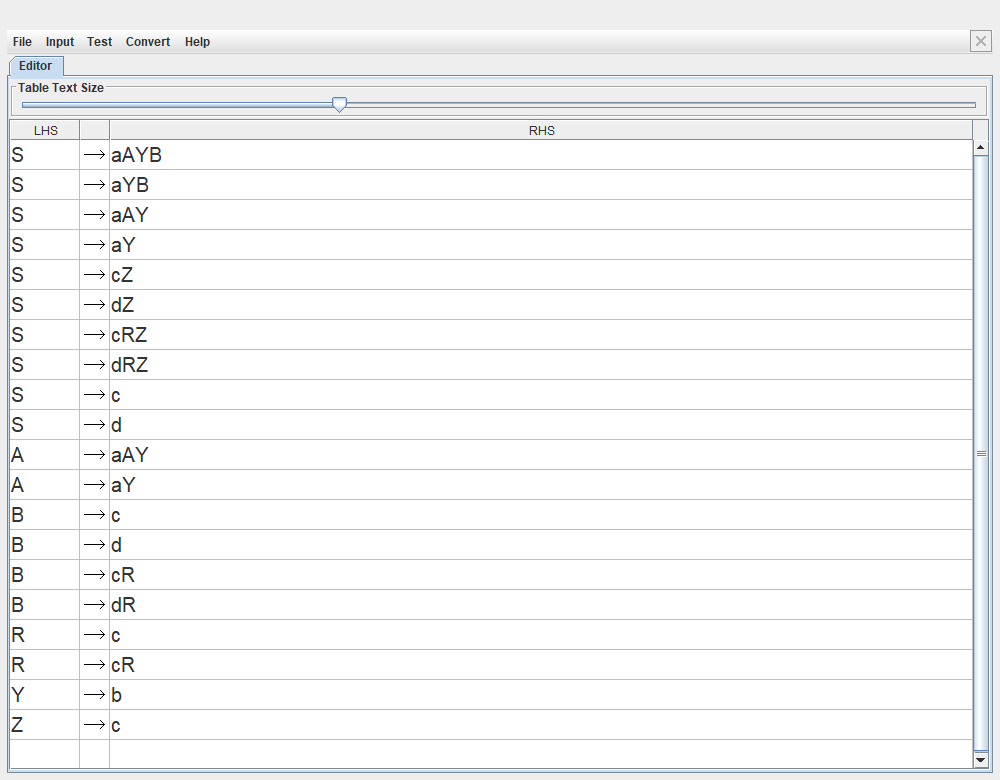
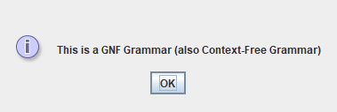
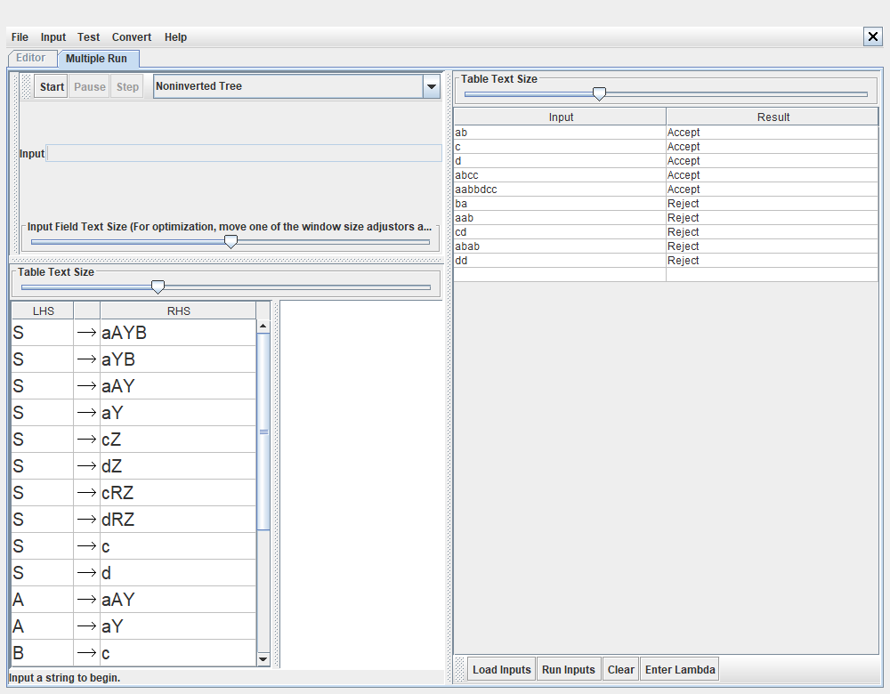

# Práctica 5 · Ejercicio 2. Forma Normal de Greibach y Forma de Backus-Naur

[← Volver al índice](../../README.md)

JFLAP no transforma una gramática a la Forma Normal de Greibach (FNG), pero *Test for Grammar Type* sí la
reconoce. La transformación se hizo a mano; el resultado se capturó en JFLAP
([`gramaticas/practica5/`](../../gramaticas/practica5/), archivos `*-FNG.jff`) y se comprobó ahí mismo con el
conjunto de cadenas del [Ejercicio 1](01-chomsky-jflap.md).

## Método

Una gramática está en Forma Normal de Greibach si todas sus producciones son **A → aα**, con a un terminal y
α una cadena, quizá vacía, de variables (Greibach, 1965). Se siguió el método de Hopcroft y Ullman (1979,
§ 4.6, teorema 4.6), que se apoya en dos lemas:

* **Sustitución** (lema 4.3). Si A → α₁Bα₂ es una producción y B → β₁ | β₂ | … | βᵣ son todas las de B, se
  puede reemplazar A → α₁Bα₂ por A → α₁β₁α₂ | α₁β₂α₂ | … | α₁βᵣα₂ sin cambiar el lenguaje.
* **Eliminación de la recursión inmediata por la izquierda** (lema 4.4). Si las producciones de A son
  A → Aα₁ | … | Aαᵣ | β₁ | … | βₛ, donde ninguna βᵢ empieza con A, se reemplazan por

  ```
  A → β₁ | … | βₛ | β₁R | … | βₛR
  R → α₁ | … | αᵣ | α₁R | … | αᵣR
  ```

  con R una variable nueva. A genera (β₁ + … + βₛ)(α₁ + … + αᵣ)* de las dos maneras; la diferencia es que la
  repetición pasa de estar a la izquierda a estar a la derecha.

Pasos:

0. Partir de una gramática sin producciones λ, sin producciones unitarias y sin símbolos inútiles (la que deja
   la etapa 3 de *Transform Grammar* en el Ejercicio 1).
1. Sustituir por una variable nueva cada terminal que no esté al principio de un lado derecho.
2. Numerar las variables A₁, …, Aₘ y, para i = 1, …, m, lograr que toda producción Aᵢ → Aⱼγ tenga j > i:
   si j < i se sustituye Aⱼ (lema 4.3) y si j = i se elimina la recursión (lema 4.4).
3. Ahora las producciones de Aₘ empiezan con terminal. Para i = m − 1, …, 1 se sustituye la variable inicial
   de cada producción de Aᵢ (lema 4.3); como esa variable tiene índice mayor, sus producciones ya empiezan
   con terminal.
4. Las variables nuevas del paso 2 (las R) tienen producciones que empiezan con alguna Aᵢ: se sustituye una
   vez más.

Linz (2017, § 6.2, teorema 6.7) enuncia el mismo resultado y usa las mismas dos reglas.

## Gramática propia

**Paso 0.** Se parte de la gramática sin λ, sin unitarias y sin inútiles del
[Ejercicio 1](01-chomsky-jflap.md#etapa-3-eliminación-de-símbolos-inútiles):

```
S → AB | aAb | ab | Bc | c | d
A → aAb | ab
B → Bc | c | d
```

**Paso 1.** Los terminales que no están al principio son b (en aAb y ab) y c (en Bc). Se introducen Y → b y
Z → c:

```
S → AB | aAY | aY | BZ | c | d
A → aAY | aY
B → BZ | c | d
Y → b
Z → c
```

**Paso 2.** Orden: A₁ = S, A₂ = A, A₃ = B (Y y Z ya están en la forma final).

* S: S → AB empieza con A₂ y S → BZ con A₃; ambos índices son mayores que 1. Nada que hacer.
* A: sus producciones empiezan con terminal. Nada que hacer.
* B: B → BZ es recursiva por la izquierda (j = i = 3). Con α₁ = Z, β₁ = c, β₂ = d, el lema 4.4 da

  ```
  B → c | d | cR | dR
  R → Z | ZR
  ```

**Paso 3.** De atrás hacia adelante:

* B ya empieza con terminal.
* A ya empieza con terminal.
* S → AB: se sustituye A por aAY y por aY: **S → aAYB | aYB**.
* S → BZ: se sustituye B por c, d, cR y dR: **S → cZ | dZ | cRZ | dRZ**.

**Paso 4.** R → Z | ZR empieza con Z; se sustituye Z → c: **R → c | cR**.

**Resultado** ([`propia-FNG.jff`](../../gramaticas/practica5/propia-FNG.jff)), 20 producciones:

```
S → aAYB | aYB | aAY | aY | cZ | dZ | cRZ | dRZ | c | d
A → aAY | aY
B → c | d | cR | dR
R → c | cR
Y → b
Z → c
```

### Comprobación en JFLAP



*Test for Grammar Type* responde «This is a GNF Grammar (also Context-Free Grammar)».



*Multiple Brute Force Parse* con las diez cadenas del Ejercicio 1 da los mismos resultados que la gramática
original y que la Forma Normal de Chomsky:

| Cadena | Original | FNC | FNG |
|---|---|---|---|
| `ab` | Accept | Accept | Accept |
| `c` | Accept | Accept | Accept |
| `d` | Accept | Accept | Accept |
| `abcc` | Accept | Accept | Accept |
| `aabbdcc` | Accept | Accept | Accept |
| `ba` | Reject | Reject | Reject |
| `aab` | Reject | Reject | Reject |
| `cd` | Reject | Reject | Reject |
| `abab` | Reject | Reject | Reject |
| `dd` | Reject | Reject | Reject |



Como en el Ejercicio 1, las pruebas automatizadas comparan todas las cadenas de longitud ≤ 10: la gramática
en FNG genera las mismas 65 que la de Chomsky, es decir, L(G) − {λ}. La cadena λ tampoco puede generarse en
la Forma Normal de Greibach: toda producción aporta un terminal.

Derivación de `aabbdcc` en la FNG, un terminal por paso (7 pasos para 7 símbolos):

```
S ⇒ aAYB ⇒ aaYYB ⇒ aabYB ⇒ aabbB ⇒ aabbdR ⇒ aabbdcR ⇒ aabbdcc
```

con las producciones S → aAYB, A → aY, Y → b, Y → b, B → dR, R → cR y R → c.

## Forma de Backus-Naur

La gramática propia original, escrita en la Forma de Backus-Naur del informe de ALGOL 60 (Backus et al.,
1960): las variables son nombres entre ángulos, `::=` separa los dos lados de una regla, `|` separa las
alternativas y los terminales se escriben tal cual. La notación no tiene símbolo para λ; el informe usa la
variable `<empty>`, definida con un lado derecho vacío.

```
<cadena>     ::= <anidada> <cola> | <ciclo>
<anidada>    ::= a <anidada> b | <vacía>
<cola>       ::= <cola> c | <opcional>
<opcional>   ::= d | <vacía>
<ciclo>      ::= <ciclo> <cadena> | a <ciclo>
<sobrante>   ::= e <anidada>
<vacía>      ::=
```

Corresponde, regla por regla, a S, A, B, D, C y E. La Forma de Backus-Naur no cambia la gramática ni la
restringe: las reglas λ, las unitarias y los símbolos inútiles (`<ciclo>`, `<sobrante>`) siguen ahí. Lo que
cambia es la escritura: los nombres largos dicen para qué sirve cada variable, cosa que una sola mayúscula no
puede hacer.

## Comparación de las tres formas

| | Forma Normal de Chomsky | Forma Normal de Greibach | Forma de Backus-Naur |
|---|---|---|---|
| Qué es | Una forma normal: restringe las producciones | Una forma normal: restringe las producciones | Una notación: cualquier gramática independiente del contexto se puede escribir así |
| Producciones permitidas | A → BC y A → a | A → aα, con α ∈ V* | Cualquier lado derecho; `<nombre> ::= … \| …` |
| Qué prohíbe | Producciones λ, unitarias, lados derechos de más de dos símbolos y mezclas de terminales con variables | Producciones λ, lados derechos que empiecen con variable (por tanto, la recursión por la izquierda) y terminales después del primer símbolo | Nada |
| ¿Puede generar λ? | No (salvo la excepción S → λ) | No (salvo la excepción S → λ) | Sí |
| Pasos para derivar una cadena de longitud n ≥ 1 | Exactamente **2n − 1** | Exactamente **n** | No está acotado por n: con producciones λ y unitarias la derivación puede ser tan larga como se quiera |
| Forma del árbol de derivación | Binario: cada nodo interno tiene dos hijos variables o un hijo terminal | Cada nodo aporta un terminal como primer hijo | Cualquiera |
| Tamaño respecto a la original | Crece poco: una variable por terminal y una por cada corte | Puede crecer mucho por las sustituciones (aquí, de 11 a 20 producciones) | El mismo |
| Para qué sirve | Demostraciones (lema de bombeo, altura de los árboles) y el algoritmo CYK, que decide en tiempo O(n³) si una cadena pertenece | Demostrar que toda gramática tiene un autómata de pila sin transiciones λ que lee un símbolo por paso; análisis descendente, porque no hay recursión por la izquierda | Definir la sintaxis de lenguajes de programación y protocolos de forma legible |

**Por qué 2n − 1 en Chomsky.** Cada producción A → BC aumenta en uno el número de símbolos de la forma
sentencial y cada A → a lo deja igual pero fija un terminal. Para pasar de un símbolo (S) a n hacen falta
n − 1 producciones del primer tipo, y para convertir las n variables en terminales, n del segundo:
(n − 1) + n = 2n − 1. En el Ejercicio 1, `aabbdcc` (n = 7) se derivó en 13 pasos.

**Por qué n en Greibach.** Cada producción A → aα escribe exactamente un terminal y ninguna otra cosa los
produce, así que una cadena de n terminales necesita n pasos: arriba, `aabbdcc` se derivó en 7.

Las pruebas `test_longitud_de_las_derivaciones` comprueban las dos cuentas para todas las cadenas de longitud
≤ 7 de cada gramática transformada. En cambio, en la gramática original la derivación más corta de `c` ya
tiene 5 pasos para un solo símbolo (S ⇒ AB ⇒ B ⇒ Bc ⇒ Dc ⇒ c), y no hay una fórmula que dependa solo de n.

## Referencias

Backus, J. W., Bauer, F. L., Green, J., Katz, C., McCarthy, J., Perlis, A. J., Rutishauser, H., Samelson, K.,
Vauquois, B., Wegstein, J. H., van Wijngaarden, A., & Woodger, M. (1960). Report on the algorithmic language
ALGOL 60 (P. Naur, Ed.). *Communications of the ACM, 3*(5), 299–311. https://doi.org/10.1145/367236.367262

Greibach, S. A. (1965). A new normal-form theorem for context-free phrase structure grammars. *Journal of the
ACM, 12*(1), 42–52. https://doi.org/10.1145/321250.321254

Hopcroft, J. E., & Ullman, J. D. (1979). *Introduction to automata theory, languages, and computation*, § 4.6.
Addison-Wesley.

Hopcroft, J. E., Motwani, R., & Ullman, J. D. (2007). *Introduction to automata theory, languages, and
computation* (3.ª ed.), § 7.1 y ejercicio 7.1.11. Pearson Addison-Wesley.

Linz, P. (2017). *An introduction to formal languages and automata* (6.ª ed.), § 6.2. Jones & Bartlett
Learning.

Las fichas completas están en la [bibliografía](../bibliografia.md).
