# Práctica 5 · Ejercicio 3. Visualización de autómatas en el software interactivo

[← Volver al índice](../../README.md)

El dibujo está programado directamente sobre el lienzo (`Canvas`) de Flet, con círculos, líneas, curvas
cuadráticas y texto; no se usa ninguna biblioteca que dibuje grafos ni ninguna herramienta externa. El trabajo
está separado en dos archivos:

| Archivo | Qué contiene | ¿Importa Flet? |
|---|---|---|
| [`src/visualizacion.py`](../../src/visualizacion.py) | **El cálculo**: la posición de cada estado, la geometría de cada flecha (dónde empieza, cuánto se curva, dónde va la etiqueta y la punta) y los cuadros de la simulación gráfica | No |
| [`src/app.py`](../../src/app.py) | **El dibujo**: `figuras` recorre lo calculado y crea las figuras del lienzo; `Lienzo` atiende el arrastre; la pestaña **9. Dibujo y simulación** conecta los botones | Sí |

Por esa separación todo lo que se decide se puede probar con pytest sin abrir una ventana (apartado 3.3).

## 3.1 Dibujo del autómata

### Qué se dibuja

Cualquier autómata definido en la pestaña 1 o importado de un archivo `.jff`, `.json` o `.xml`, sea AFD, AFN o
AFN-λ:

| Elemento | Cómo se representa |
|---|---|
| Estado | Círculo con su nombre |
| Estado inicial | Flecha de entrada por la izquierda |
| Estado de aceptación | Doble círculo |
| Transiciones de q a p | Una sola flecha con todos sus símbolos en la etiqueta (`a,b`); λ va al final (`a,λ`). Si son más de seis símbolos la etiqueta se abrevia: `a,b,c,d,…(10)` |
| Ciclo sobre un estado | Lazo: un círculo pequeño pegado al estado, con su etiqueta afuera |
| Transiciones en ambos sentidos | Dos curvas, una a cada lado de la recta que une los estados, cada una con su etiqueta |

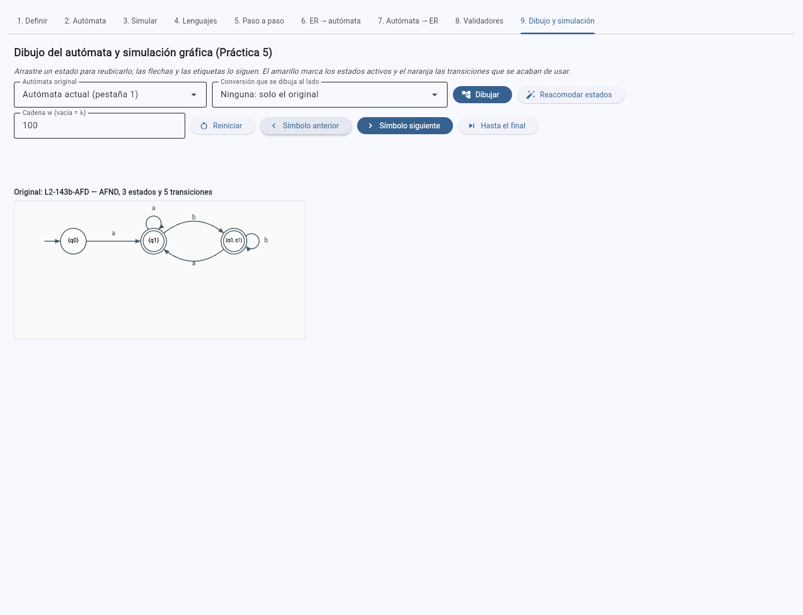

### Posición inicial de los estados

`calcular_posiciones` es un procedimiento propio, por capas:

1. **Nivel de cada estado**: su distancia a q0 en un recorrido en anchura (`niveles`). Los estados
   inaccesibles se recorren después, cada grupo desde el nivel 0, para que también tengan lugar.
2. **Una columna por nivel**: el inicial queda a la izquierda y las transiciones avanzan, en general, hacia la
   derecha.
3. **Orden dentro de cada columna** (`_ordenar_columnas`): cada estado se coloca a la altura promedio
   (baricentro) de sus vecinos de la columna contigua. Se barre cuatro veces de izquierda a derecha y de
   derecha a izquierda. Así los estados conectados quedan a alturas parecidas y hay menos cruces; el orden en
   que el usuario definió los estados sirve de desempate, por lo que el resultado es siempre el mismo.
4. **Coordenadas**: las columnas se separan 150 píxeles, los estados de una columna 105, y cada columna se
   centra respecto a la más alta.

Dos estados no pueden recibir la misma posición: si están en columnas distintas difieren en x, y si están en
la misma, en y. Con el AFN-λ 199 de la Lista 3 los niveles son A: 0; B, E, C: 1; D: 2, y las posiciones (110,
180), (260, 75), (260, 180), (260, 285) y (410, 180).

### Flechas que no se enciman

`construir_escena` decide la forma de cada flecha:

* **Ida y vuelta.** Si existen q → p y p → q, cada flecha se curva 30 píxeles hacia *su* izquierda. Como avanzan
  en sentidos contrarios, quedan a lados opuestos de la recta que une los centros, separadas 60 píxeles en el
  punto medio, y cada etiqueta va del lado de afuera de su curva.
* **Flechas largas.** Una flecha recta de q a p puede pasar por encima de un tercer estado (por ejemplo, de la
  columna 0 a la 2 atravesando la 1). Se muestrea la flecha en 23 puntos; si alguno queda a menos de un radio
  más 7 píxeles del centro de otro estado, se prueba con curvas cada vez más abiertas, a un lado y al otro
  (40, 75, 110 y 150 píxeles), y se toma la primera que queda libre. En la captura del 199, A → C se curva
  porque también existe C → A.
* **Lazos.** El lazo se dibuja hacia arriba, salvo que arriba haya otra flecha: de ocho direcciones se elige la
  más alejada de las demás flechas del estado y de la flecha de entrada del inicial. En el 199 el lazo de C
  sale hacia abajo porque arriba está la flecha C → E, y el de D hacia la derecha.
* **Extremos.** Cada flecha empieza y termina en el borde del círculo, no en el centro, y la punta sigue la
  dirección con la que la curva llega.

### Reubicar estados arrastrándolos

Cada dibujo es un `Lienzo`: el `Canvas` dentro de un `GestureDetector`. Al empezar a arrastrar, `estado_en`
busca el estado que está bajo el puntero; mientras se arrastra, `mover_estado` cambia solo la posición de ese
estado y `construir_escena` recalcula las flechas, las curvas y las etiquetas, que por eso siguen al estado.
`mover_estado` no deja sacar el estado por arriba ni por la izquierda, ni soltarlo encima de otro. El botón
*Reacomodar estados* vuelve a las posiciones calculadas. Las posiciones arrastradas se recuerdan mientras la
aplicación está abierta, así que no se pierden al avanzar un paso o cambiar de pestaña.

El estado {q0, q1} arrastrado hacia abajo: las dos curvas, sus etiquetas y el lazo se recalculan con la nueva
posición.

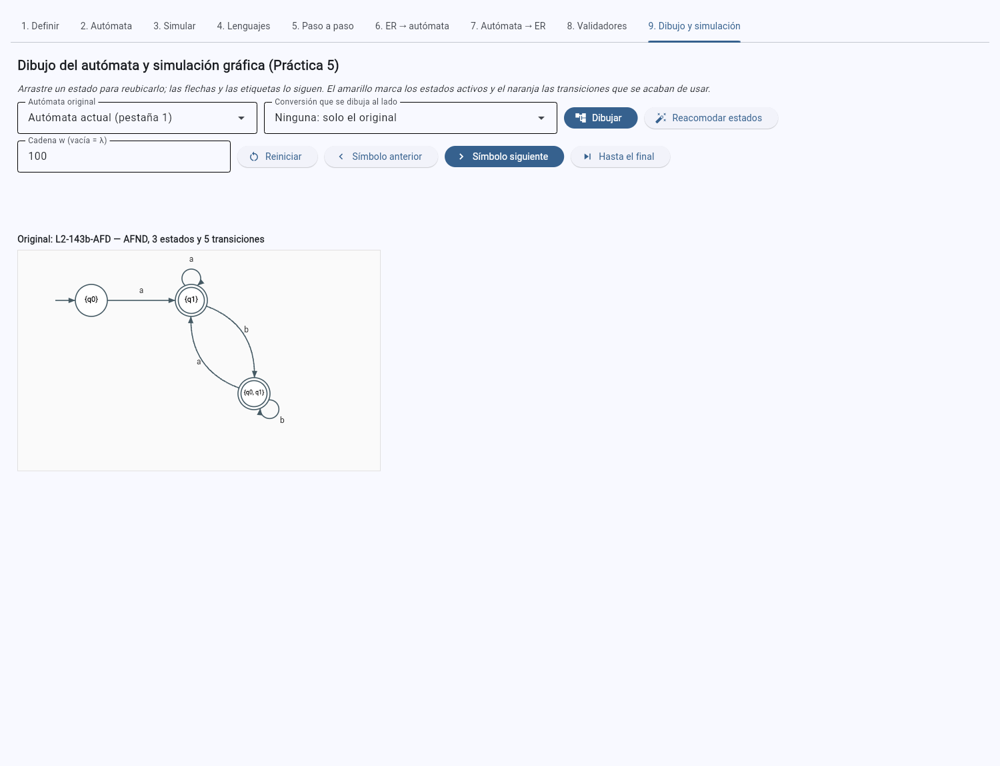

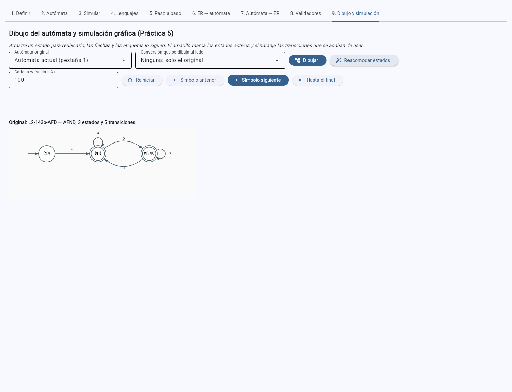

### El dibujo en los resultados de las Prácticas 3 y 4

Todos los diagramas del programa usan ya este dibujo (la función `diagrama` crea un `Lienzo`): la pestaña 2,
la simulación de la pestaña 3, los pasos de los algoritmos de la Práctica 3 (pestaña 5), la construcción del
AFN-λ de una expresión y sus etapas (pestaña 6), el autómata generalizado de la eliminación de estados
(pestaña 7) y los AFD de los validadores (pestaña 8). En todos se pueden arrastrar los estados.

Además, la pestaña 9 dibuja **el autómata original y, al lado, el obtenido por una conversión**
(`visualizacion.convertir` llama a los algoritmos de las prácticas anteriores, no los repite):

| Conversión | De dónde sale |
|---|---|
| Eliminación de transiciones λ | Práctica 3, 2.2 (`eliminar_lambda`) |
| Construcción de subconjuntos | Práctica 3, 2.3 (`construir_subconjuntos`) |
| Minimización | Práctica 3, 2.4 (`minimizar_afd`) |
| Autómata → ER → AFN-λ | Práctica 4: eliminación de estados sobre el AFD mínimo (Kleene II) y construcción del AFN-λ de la expresión obtenida (Kleene I) |

El original puede ser el autómata actual o el AFN-λ de la expresión construida en la pestaña 6.

AFN-λ 199 y el AFN sin λ (mismos estados; se quitaron 3 transiciones λ y se añadieron 8):

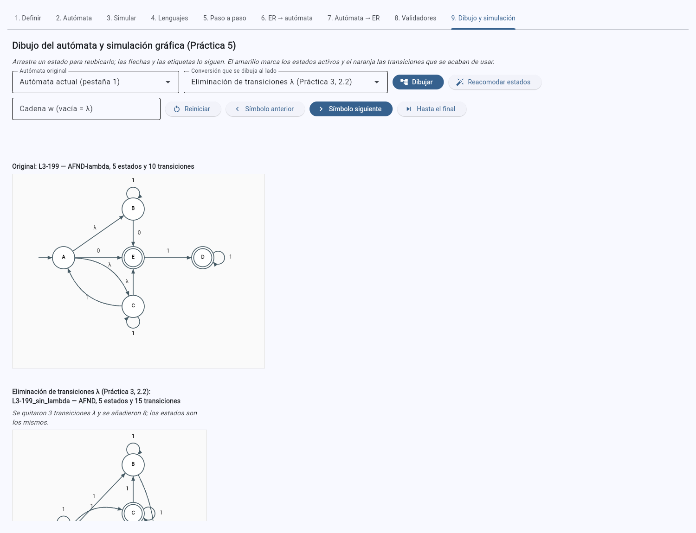

AFN-λ 199 y su AFD por subconjuntos (5 estados alcanzables de 2⁵ posibles):

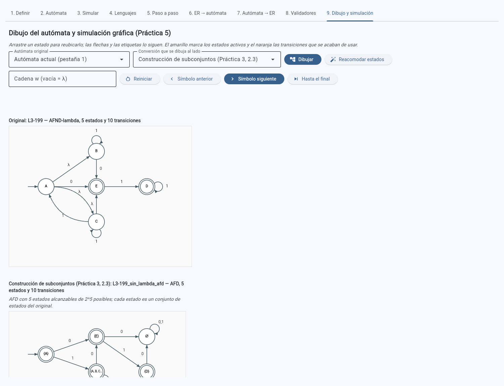

AFN-λ 199 y su AFD mínimo (3 estados):

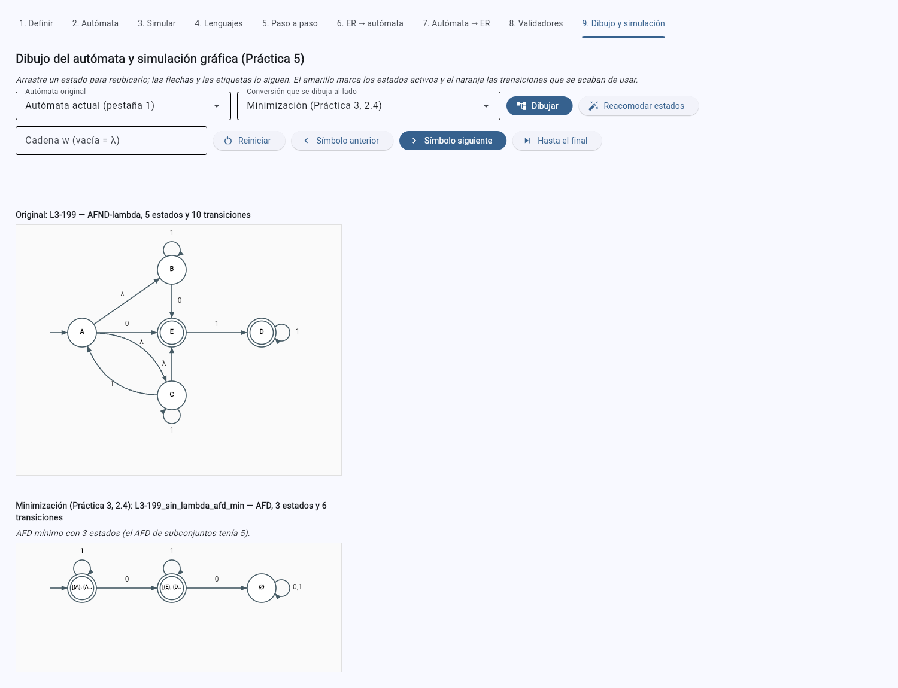

AFN-λ 199 y el AFN-λ de la expresión 1\*(λ+01\*) que se obtiene de su AFD mínimo (14 estados):

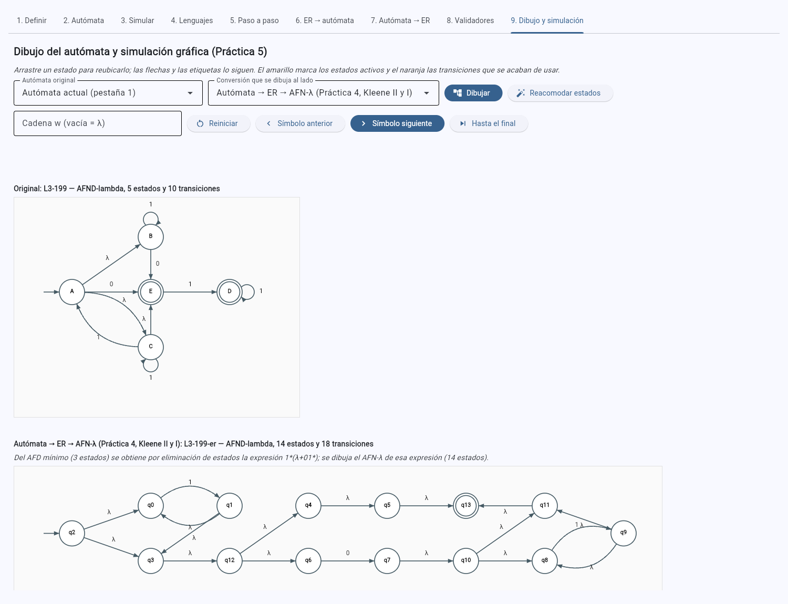

La expresión (a+b)\*abb de la pestaña 6: su AFN-λ de 14 estados y, debajo, su AFD mínimo de 4:

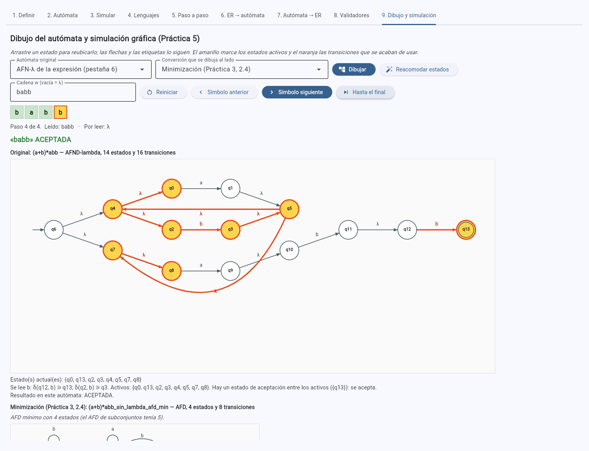

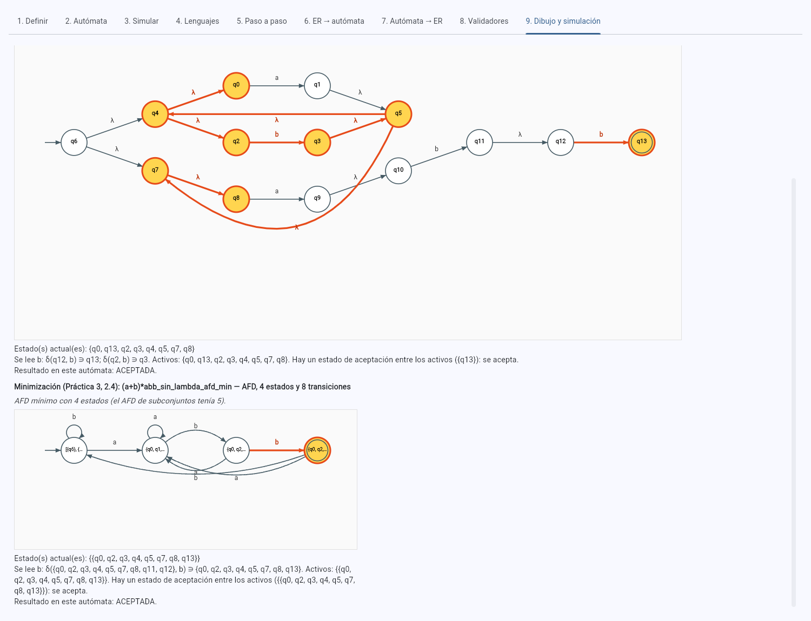

## 3.2 Simulación gráfica

En la pestaña 9 se escribe la cadena y se recorre con *Símbolo siguiente* y *Símbolo anterior* (*Reiniciar* y
*Hasta el final* llevan a los extremos). La simulación corre a la vez en el original y en el convertido, de
modo que se ve cómo los dos llegan al mismo veredicto por caminos distintos.

`SimulacionGrafica` arma un **cuadro** por cada momento: el cuadro 0, antes de leer, y uno más por símbolo.
No vuelve a simular: toma los pasos de `Automata.traza`, el simulador de las prácticas anteriores, y guarda en
cada cuadro lo que hay que resaltar:

| Lo que se ve | De dónde sale |
|---|---|
| Estados en **amarillo con borde naranja** | `Cuadro.activos`: el estado actual en un AFD; en un autómata no determinista, el conjunto de estados activos después de la cerradura λ |
| Flechas en **naranja** | `Cuadro.usadas` (las transiciones con las que se leyó el símbolo) y `Cuadro.por_lambda` (las λ que se siguieron después) |
| La cinta | Los símbolos ya leídos en verde, el recién leído en amarillo y los pendientes en blanco; debajo, «Leído: … · Por leer: …» |
| El texto bajo cada dibujo | `SimulacionGrafica.explicar`: las transiciones δ(q, a) ∋ p usadas y los activos |
| El veredicto | Al llegar al último cuadro: ACEPTADA si algún estado activo es de aceptación, RECHAZADA si no |

Cadena `1011` en el AFN-λ 199 y en su AFD. Cuadro 0: antes de leer, la cerradura λ de A activa A, B, C y E.

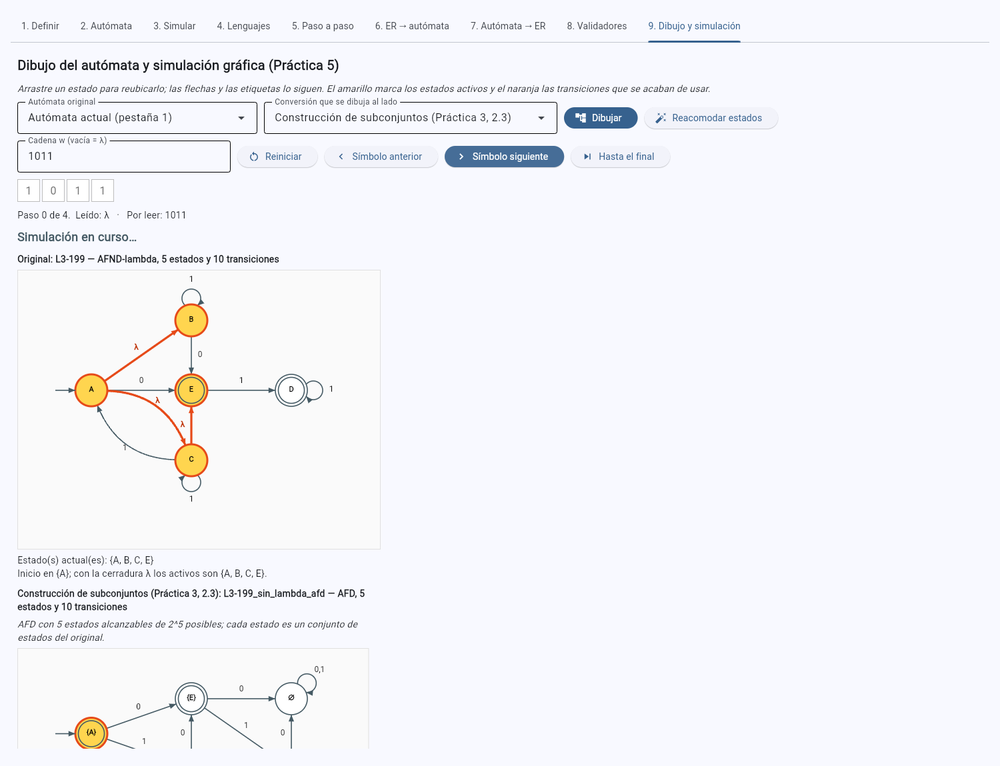

Después de leer `1`:

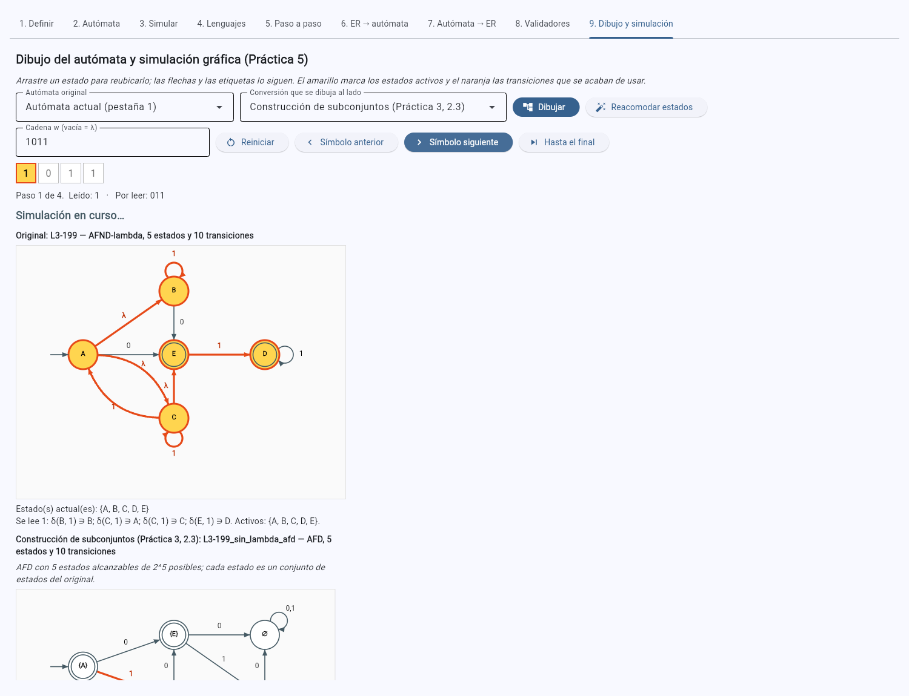

Después de leer `10`: solo queda activo E, al que se llegó con δ(A, 0) y con δ(B, 0); en el AFD se resalta el
estado {E}.

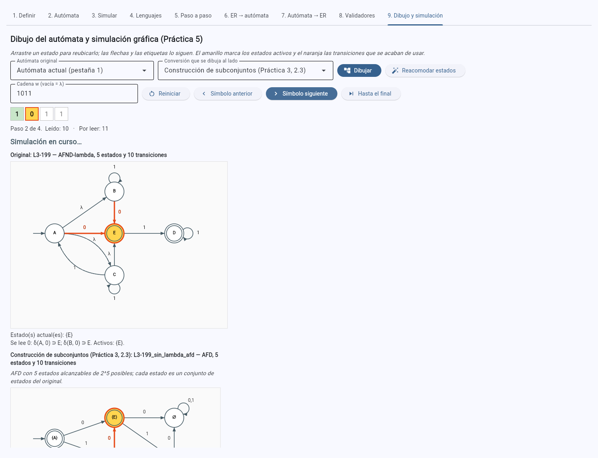

*Símbolo anterior* regresa al cuadro previo (la cinta vuelve a marcar el primer símbolo):

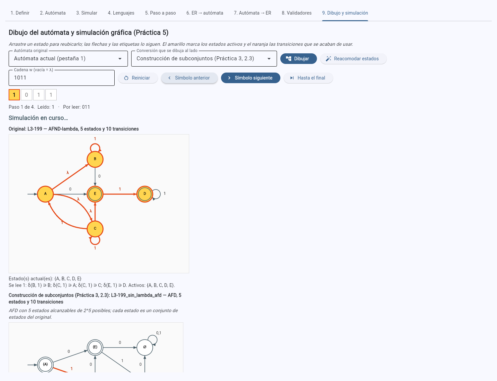

Al terminar, el veredicto: `1011` se acepta porque D está entre los activos.

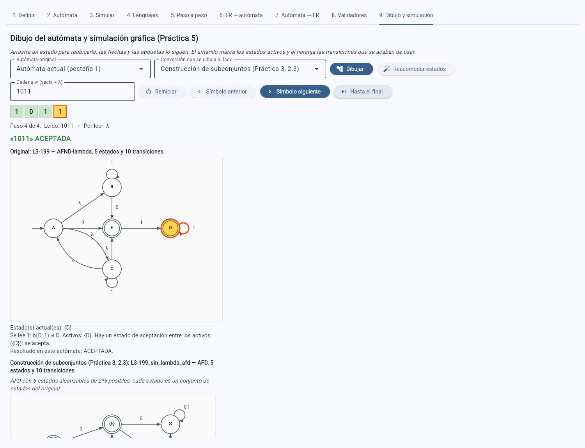

Con `100` el tercer símbolo no tiene transición desde E: no queda ningún estado activo y la cadena se
rechaza (en el AFD, el estado resaltado es el sumidero ∅).

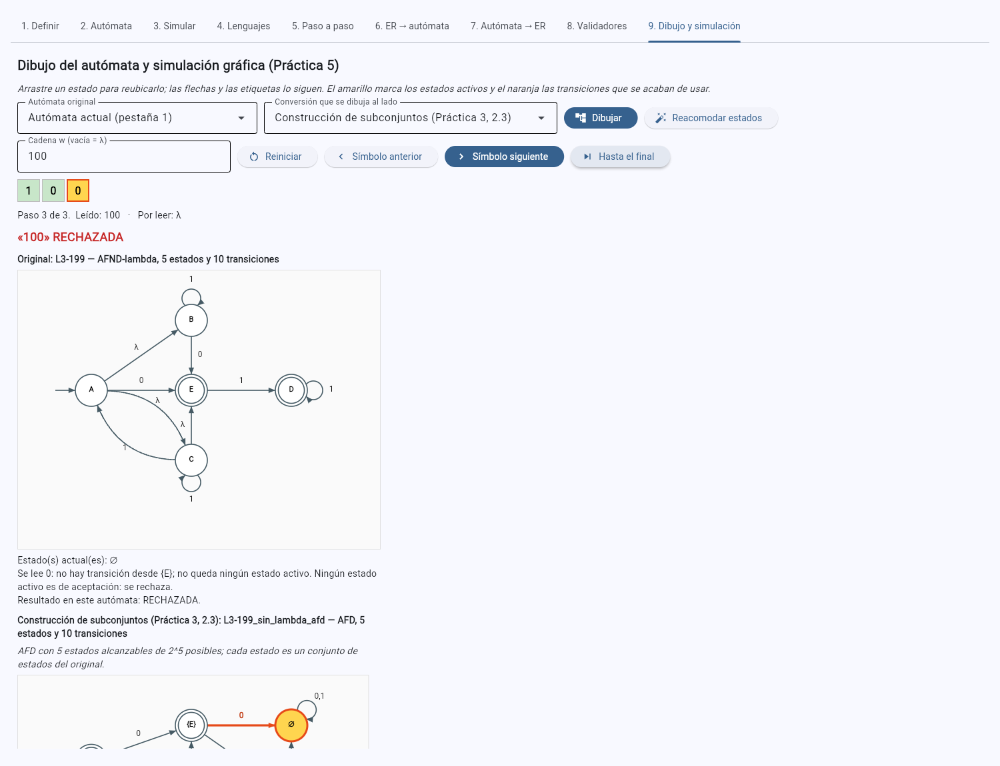

Si la cadena tiene un símbolo que no está en Σ, el programa lo avisa y la simulación se queda sin estados
activos al leerlo.

## 3.3 Pruebas automatizadas

[`tests/test_practica5.py`](../../tests/test_practica5.py) prueba `visualizacion.py` sin interfaz. Las pruebas
«de todo el repositorio» se repiten con cada autómata guardado en `automatas/` (483 archivos).

| Qué pide el enunciado | Pruebas | Con qué |
|---|---|---|
| La posición de cada estado es única | `test_la_posicion_de_cada_estado_es_unica`, `test_los_circulos_de_dos_estados_no_se_tocan`, `test_los_estados_inaccesibles_tambien_tienen_posicion` | Todo el repositorio, los autómatas de cada conversión y los de seis expresiones |
| La secuencia de estados resaltados coincide con el recorrido del simulador | `test_los_estados_resaltados_son_los_del_simulador` (contra `simular_directo` y contra δ̂), `test_en_un_afd_se_resalta_un_solo_estado_y_es_el_de_delta`, `test_las_transiciones_resaltadas_existen_y_llevan_a_los_activos` | Los 19 casos de la Práctica 3 con todas las cadenas de longitud ≤ 5 |
| El resultado final coincide con el de las prácticas anteriores | `test_el_resultado_coincide_en_los_cuatro_autómatas_de_la_practica_3`, `test_el_resultado_coincide_con_la_practica_4` (contra `re.fullmatch`) | Los 19 casos de la Práctica 3 y seis expresiones de la Práctica 4 |

Además se prueba la geometría (ida y vuelta a lados opuestos, lazos fuera del círculo y lejos de las demás
flechas, flechas largas que rodean al estado intermedio, extremos en el borde de los círculos, etiquetas), el
arrastre (`estado_en`, `mover_estado`), avanzar y retroceder (los límites y que al regresar se obtiene el
mismo cuadro), la cadena vacía, los símbolos fuera de Σ y que cada conversión da un autómata equivalente.

En total el archivo tiene 2607 pruebas (la mayoría, las repeticiones por autómata) y
[`tests/test_practica5_gramaticas.py`](../../tests/test_practica5_gramaticas.py) otras 10 para los Ejercicios
1 y 2. Con las de las prácticas anteriores son 3660, que se ejecutan en la integración continua con Python
3.11, 3.12 y 3.13 (`.github/workflows/pruebas.yml`); la evidencia está en
[`evidencias/practica5/ci/`](../../evidencias/practica5/ci/).

```
pytest -q                          # todas
pytest -q tests/test_practica5.py  # solo el Ejercicio 3
```

## Uso

1. Abra el programa: `python src/app.py`.
2. Cargue un autómata en la pestaña **1. Definir** (o construya una expresión en la pestaña 6).
3. Pestaña **9. Dibujo y simulación**: elija el *Autómata original* y la *Conversión que se dibuja al lado*.
   Arrastre los estados con el ratón; *Reacomodar estados* deshace el arrastre.
4. Escriba la cadena y avance con *Símbolo siguiente*.

Las capturas de este documento se generan con `herramientas/capturas_p5.py`, que hace los clics y el arrastre
en la aplicación en modo web.
